<div align="center">

  <a href="https://youtu.be/k6_TMKBE_Oc">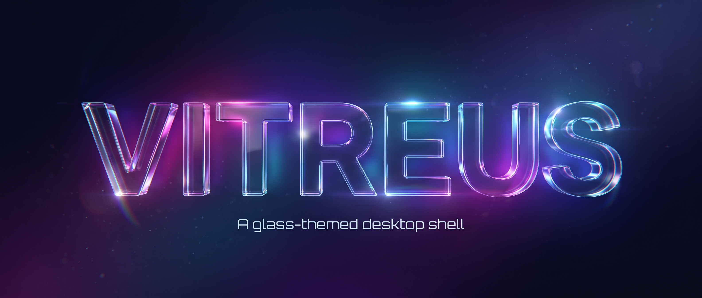</a>

  <p><sub>Click the banner to see a demo</sub></p>

  <p><strong>A liquid-glass desktop shell: a bar, and panels that flow out of it.</strong></p>

  <p>
    <a href="https://github.com/k4ditano/pleamar"></a>
    <a href="https://hyprland.org"></a>
    <a href="https://github.com/niri-wm/niri"></a>
    <a href="LICENSE"></a>
  </p>

  <table>
    <tr>
      <td align="center">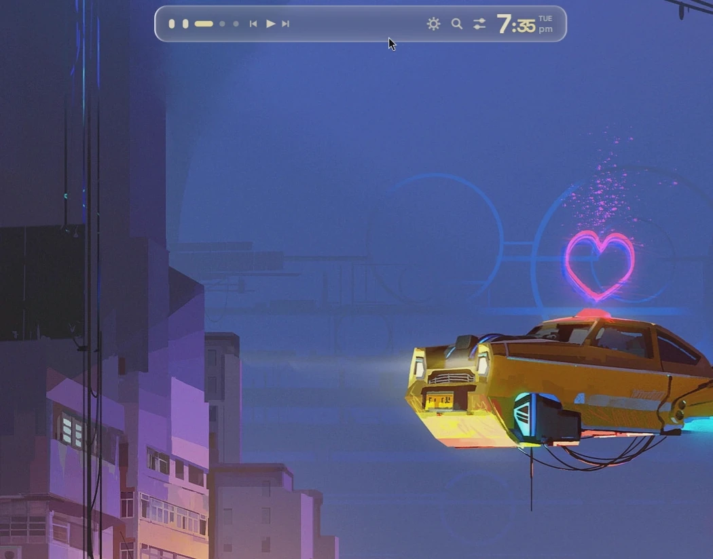<br /><sub>Panels flowing out of the bar</sub></td>
      <td align="center">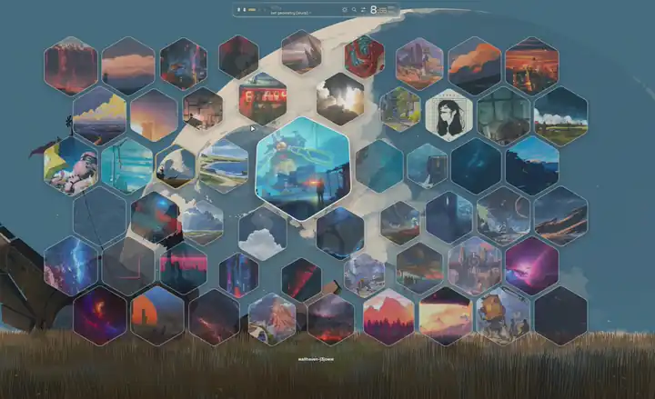<br /><sub>The wallpaper picker (<code>SUPER + B</code>)</sub></td>
    </tr>
    <tr>
      <td align="center">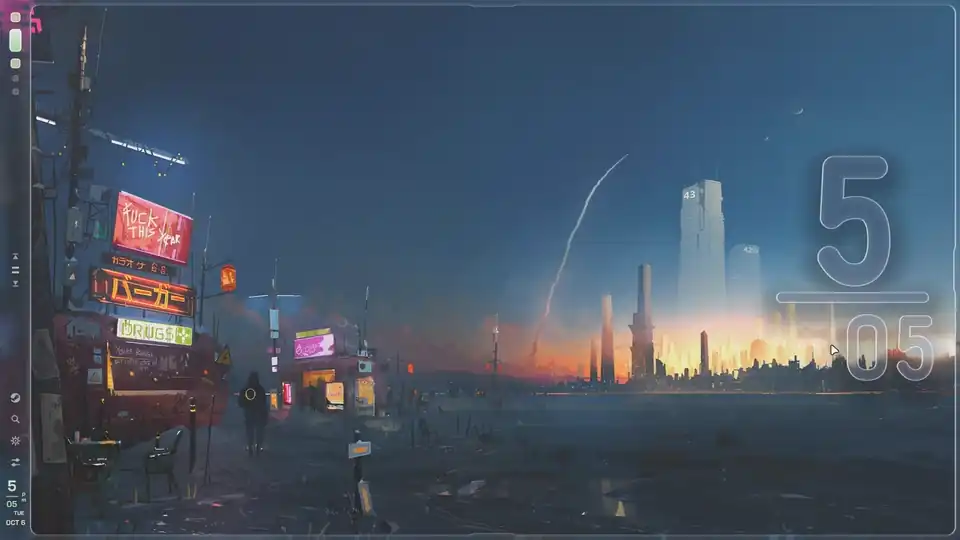<br /><sub>A tour</sub></td>
      <td align="center">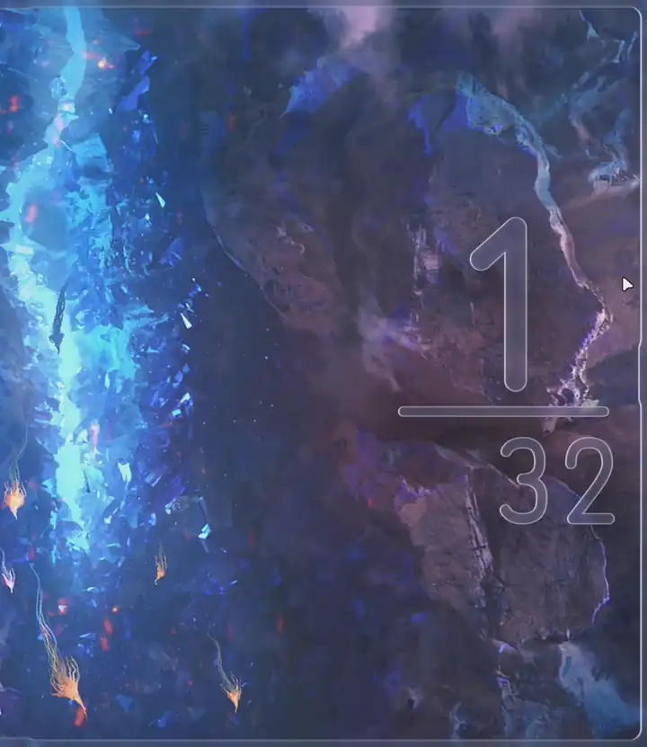<br /><sub>The Desk</sub></td>
    </tr>
  <tr>
    <td align="center">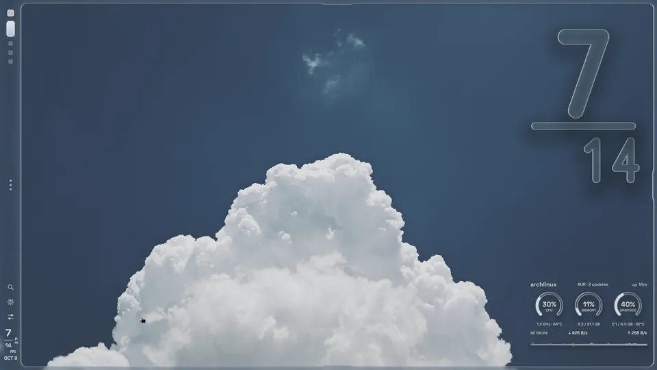<br /><sub>The lock screen</sub></td>
    <td align="center"><br /><sub>Every theme: a notification, Controls, the Desk, Settings and Search</sub></td>
  </tr>
  </table>

</div>

---

> **vit·re·us** _(Latin)_ — *of glass; glassy, transparent.*

**Vitreus** is a desktop shell for Wayland, built on [pleamar](https://github.com/k4ditano/pleamar). It's a bar of frosted
glass, and everything else (the calendar, the controls, the player, the launcher, a notification) grows out of it like
liquid and folds back in. A shell that morphs instead of pops.

It runs on **Hyprland**, **niri** and **pleamar-wm**.

> [!WARNING]
> Vitreus is in active development, so things can change or break between updates. It was built with AI tools.

---

## 🚀 Install

```sh
curl -fsSL https://raw.githubusercontent.com/natepayn3/Vitreus/main/install.sh | sh
```

It asks before each step, and running it again updates Vitreus. On Arch it does everything; on other distributions it
installs the shell and tells you what to add by hand.

**Just want to try it?** Add `--test`. Your current setup stays as it is, and `./install.sh --stop` puts it back:

```sh
curl -fsSL https://raw.githubusercontent.com/natepayn3/Vitreus/main/install.sh | sh -s -- --test
```

Requirements, options, Debian/Ubuntu and setting it up by hand are in **[docs/INSTALL.md](docs/INSTALL.md)**.

---

## ⌨️ The keys you need

| Keys | Opens |
| --- | --- |
| `SUPER + Space` | Launcher |
| `SUPER + SHIFT + Space` | Settings |
| `SUPER + SHIFT + D` | Dashboard |
| `SUPER + D` | Desk |
| `SUPER + B` | Wallpaper picker |
| `SUPER + TAB` | Workspace overview |
| `SUPER + E` | Files |
| `SUPER + C` | Control Center |
| `SUPER + A` / `SUPER + CTRL + A` / `SUPER + SHIFT + A` | Screenshot of a region (Snap) / of the whole screen / screen recording |
| `SUPER + L` | Lock |

---

## ✨ What's inside

**Everyday**
* **Three layouts**: a floating *island* pill, a *frame* round the screen, or *notches* hanging from the top edge.
* **Launcher**: apps, files, emoji, clipboard, wallpapers, sums and conversions (`5 km to mi`), web searches (`!yt lofi`) and open windows (`@`).
* **Controls**: Wi-Fi, Bluetooth, brightness, volume per app, Do Not Disturb, Caffeine, and power.
* **Calendar** with reminders in plain words (`3:30pm Call mom`) and the week's weather.
* **Notifications** with history, per-app rules and sounds, and quiet hours.
* **Player** with cover art and a live spectrum.

**Bigger panels**
* **Dashboard**: one screen of glass cards (clock, weather, notifications, system monitor, what's playing).
* **myPad** (SUPER + D): the Desk as a tablet out of the frame. A home screen with your picture, a slideshow, your AUR updates, the apps and what is playing, and apps for notes and reminders, drawing, the shelf, the clipboard, focus, a terminal, Ask (an AI chat with whichever assistant you have: Claude Code, Ollama, Codex or Gemini), a camera with live looks, and voice memos.
* **Wallpaper picker**: a honeycomb of glass hexagons, or a row of cards that previews each wallpaper live.
* **Workspace overview**: a card per workspace; drag windows between them.

**Apps of its own**
* **Snap**: freeze the screen, pick a window or area, draw on it, blur out private details, and copy, save or drag it anywhere.
* **Files**: a full file manager in the shell's look ([more](files/README.md)).
* **View**: a picture and video viewer: flip through a folder, zoom, rotate, slideshow, edit in Snap, or set as wallpaper. The installer can make it your default viewer.

**Around the edges**
* **Lock screen**, a matching **login screen** ([SDDM theme](sddm/README.md)) with your own picture or a looping video (**Settings > Greeter**), and a **polkit** password dialog.
* **Audio visualiser**: the bottom edge of the screen rises with the music.
* **Desktop**: right-click the wallpaper for sticky notes, a clock and a system monitor.
* **Parallax**: the wallpaper leans away from the pointer, as far and as loosely as you set it (**Settings > Wallpaper**).
* **Night mode** and a **desktop clock**.

---

## 🎨 Themes

**Glass** recolours itself from your wallpaper. There are also **Retro**, **UwU**, **Cyber**, **Milkbox**, **Doodle**, **Paper**
and **Proxy**, each with its own shape and typeface. Pick one in **Settings > Theme**.

Want your own? Copy `themes/_template.toml` into `~/.config/pleamar/vitreus-themes/` and change the colours. [How themes work](themes/README.md)

## 🧩 Add-ons

Extra widgets and panels you switch on in **Settings > Add-ons**. Vitreus comes with **News & Weather**, **Home Assistant**,
**TV Remote**, **VPN** and an **EQ**, and you can write your own. [Add-ons guide](addons/README.md)

---

## 📸 Screenshots

<table>
  <tr>
    <td align="center" colspan="2"><br /><sub><b>Dashboard</b> (<code>SUPER + SHIFT + D</code>) — everything at a glance, surfacing through the glass</sub></td>
  </tr>
  <tr>
    <td align="center" colspan="2"><br /><sub><b>Snap</b> — click a window or drag an area, then draw on it, redact, copy</sub></td>
  </tr>
  <tr>
    <td align="center">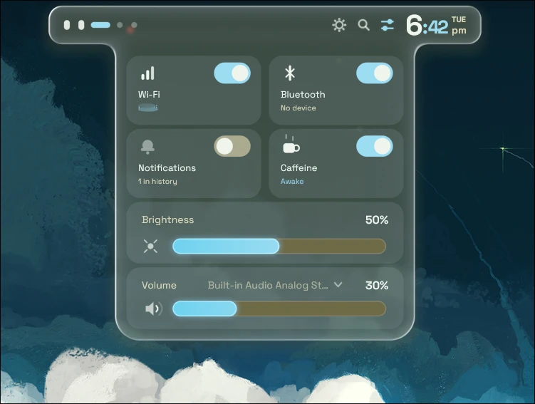<br /><sub><b>Controls</b> — Wi-Fi, Bluetooth, brightness and volume</sub></td>
    <td align="center">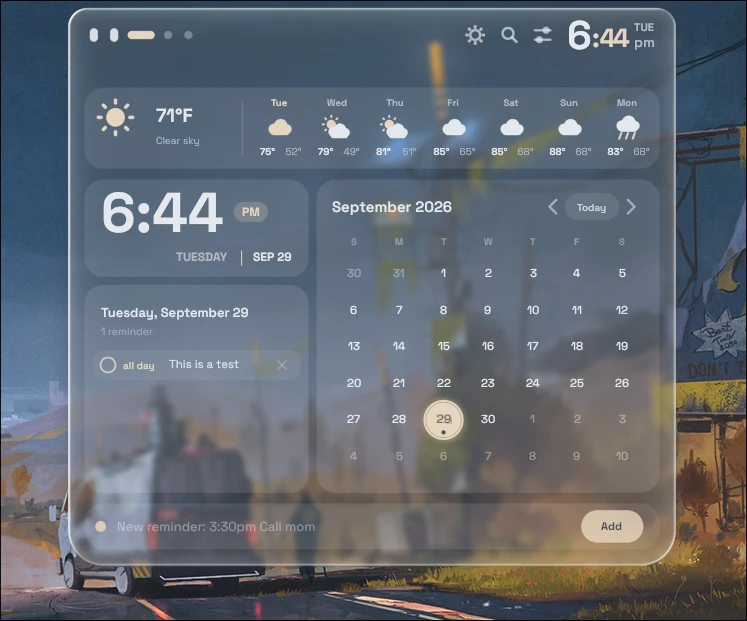<br /><sub><b>Calendar</b> — weather, month, and reminders</sub></td>
  </tr>
  <tr>
    <td align="center">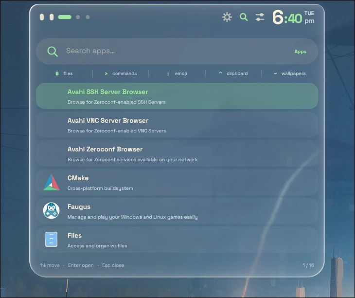<br /><sub><b>Launcher</b> — apps, files, commands, emoji, clipboard, wallpapers</sub></td>
    <td align="center">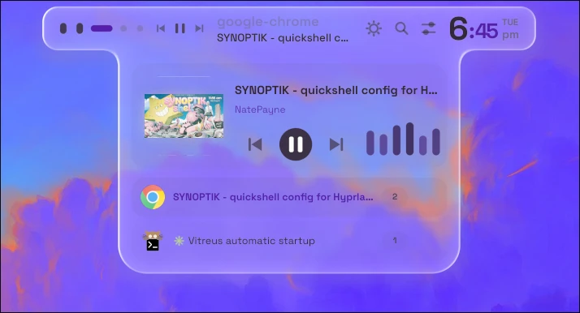<br /><sub><b>Player and windows</b> — hangs from the window title</sub></td>
  </tr>
  <tr>
    <td align="center">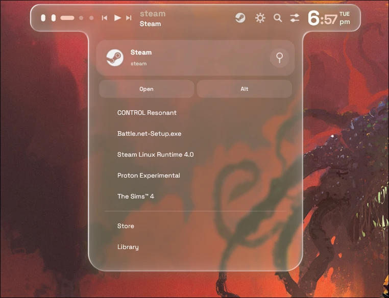<br /><sub><b>System tray</b> — an app's own menu, drawn in the shell's glass</sub></td>
    <td align="center">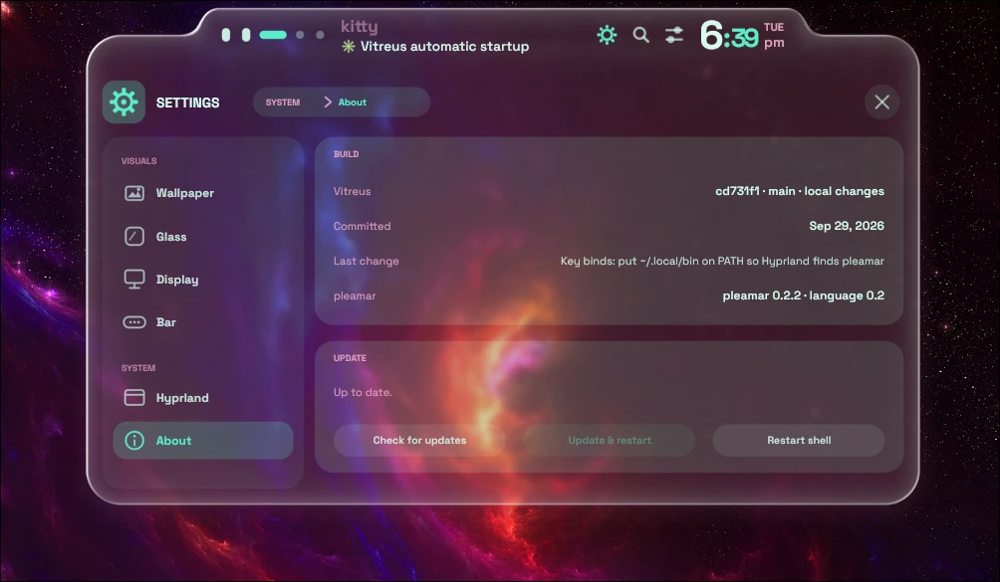<br /><sub><b>Settings</b> — the About page shows the build and updates the shell</sub></td>
  </tr>
</table>

---

## 🆘 Something not working?

Run this. It works even if Vitreus won't install or start:

```sh
curl -fsSL https://raw.githubusercontent.com/natepayn3/Vitreus/main/bin/vitreus-report | sh
```

It asks what went wrong and writes one plain-text file you can read first. Your user name, computer name, network addresses
and monitor names are blanked out, and it doesn't read your notifications, clipboard, calendar or files. Attach it to a
[GitHub issue](https://github.com/natepayn3/Vitreus/issues/new/choose), or e-mail it to natepayn3@gmail.com if you have no account.
Once Vitreus is installed it's just `vitreus-report`.

---

## 📄 License

Vitreus is released under the [MIT License](LICENSE). It runs on [pleamar](https://github.com/k4ditano/pleamar), which
is BSD-3-Clause and is not part of this repository.

## ⭐ Star History


<a href="https://www.star-history.com/?repos=natepayn3%2Fvitreus&type=date&legend=top-left">
 <picture>
   <source media="(prefers-color-scheme: dark)" srcset="https://api.star-history.com/chart?repos=natepayn3/vitreus&type=date&theme=dark&legend=top-left" />
   <source media="(prefers-color-scheme: light)" srcset="https://api.star-history.com/chart?repos=natepayn3/vitreus&type=date&legend=top-left" />
   
 </picture>
</a>
