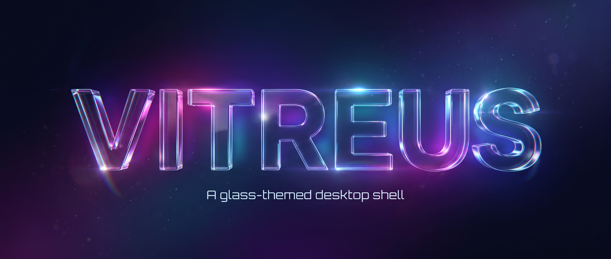
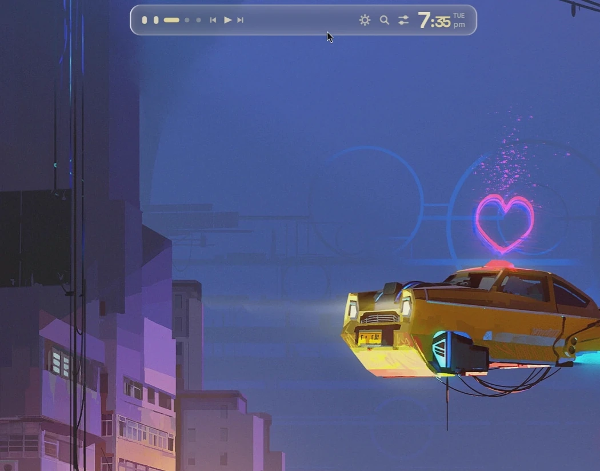
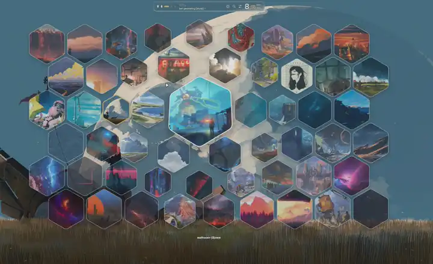
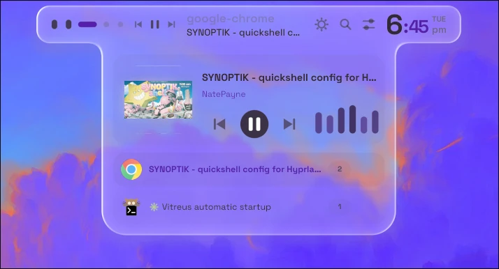
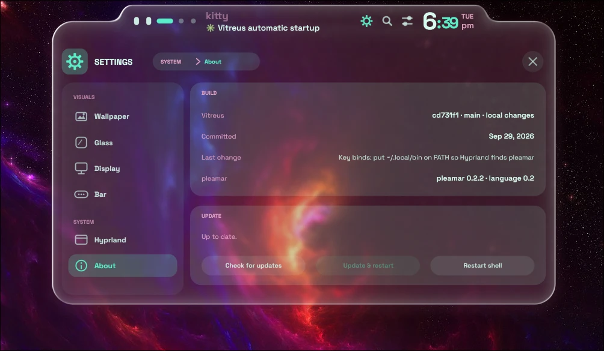

<div align="center">

  <a href="https://youtu.be/k6_TMKBE_Oc"></a>

  <p><sub>Click the banner to see a demo</sub></p>

  <p><strong>A liquid-glass desktop shell: a bar, and panels that flow out of it.</strong></p>

  <p>
    <a href="https://github.com/k4ditano/pleamar"></a>
    <a href="https://hyprland.org"></a>
    <a href="https://github.com/niri-wm/niri"></a>
    <a href="LICENSE"></a>
  </p>

  <table>
    <tr>
      <td align="center"><br /><sub>Panels flowing out of the bar</sub></td>
      <td align="center"><br /><sub>The wallpaper picker (<code>SUPER + B</code>)</sub></td>
    </tr>
    <tr>
      <td align="center"><br /><sub>A tour</sub></td>
      <td align="center"><br /><sub>The Desk</sub></td>
    </tr>
  <tr>
    <td align="center" colspan="2"><br /><sub>The lock screen</sub></td>
  </tr>
  </table>

</div>

---

> [!WARNING]
> **Vitreus is in active development.** Features, settings and behaviour can change at any time, and things may break
> between updates.
>
> **AI Disclosure:** Vitreus was built with AI tools

> **vit·re·us** _(Latin)_ — *of glass; glassy, transparent.*

**Vitreus** is a desktop shell for Wayland, written for [pleamar](https://github.com/k4ditano/pleamar). It is a single
floating pill of frosted glass at the top of the screen, or a strip down the left edge with a thin glass frame round
the screen. Everything else — the calendar, the quick controls, the player, the settings, the launcher, the volume
indicator, an incoming notification — is a drawer that grows out of the bar, joined to it by a liquid neck, in the same
glass, with the same spring, and folds back into it.

It is built to be *not boring*: a shell that morphs rather than pops. On pleamar the animation, the springs and the
layout all run in the renderer, and the logic only reports facts.

**Install it:**

```sh
curl -fsSL https://raw.githubusercontent.com/natepayn3/Vitreus/main/install.sh | sh
```

Want to try it without breaking your current setup?

```sh
curl -fsSL https://raw.githubusercontent.com/natepayn3/Vitreus/main/install.sh | sh -s -- --test
```

`--test` changes nothing at login, stops your Quickshell and starts Vitreus, and `./install.sh --stop` (from `~/.config/pleamar/shells/vitreus`) brings yours back.
See [Installation](#-installation).

**Something not working?** Run this. It works even when Vitreus would not install or will not start:

```sh
curl -fsSL https://raw.githubusercontent.com/natepayn3/Vitreus/main/bin/vitreus-report | sh
```

It asks what went wrong and writes one plain-text file you can read first (your user name, computer name, network addresses
and monitors' names are blanked out; it does not read your notifications, clipboard, calendar or files). Then it tells you how
to send it: attach it to a [GitHub issue](https://github.com/natepayn3/Vitreus/issues/new/choose), or e-mail it to
natepayn3@gmail.com if you have no account. With Vitreus installed it is just `vitreus-report`.

---

## 📸 Screenshots

<table>
  <tr>
    <td align="center" colspan="2"><br /><sub><b>Dashboard</b> (<code>SUPER + SHIFT + D</code>) — everything at a glance, surfacing through the glass</sub></td>
  </tr>
  <tr>
    <td align="center" colspan="2"><br /><sub><b>Snap</b> — click a window or drag an area, then draw on it, redact, copy</sub></td>
  </tr>
  <tr>
    <td align="center"><br /><sub><b>Controls</b> — Wi-Fi, Bluetooth, brightness and volume</sub></td>
    <td align="center"><br /><sub><b>Calendar</b> — weather, month, and reminders</sub></td>
  </tr>
  <tr>
    <td align="center"><br /><sub><b>Launcher</b> — apps, files, commands, emoji, clipboard, wallpapers</sub></td>
    <td align="center"><br /><sub><b>Player and windows</b> — hangs from the window title</sub></td>
  </tr>
  <tr>
    <td align="center"><br /><sub><b>System tray</b> — an app's own menu, drawn in the shell's glass</sub></td>
    <td align="center"><br /><sub><b>Settings</b> — the About page shows the build and updates the shell</sub></td>
  </tr>
</table>

---

## ✨ Features

* **Three layouts** — an *island* pill along the top; a *frame*: a strip on any edge with glass round the screen; or *notches*: a thin frame with the bar in three pieces of glass (workspaces, clock and title, controls) hanging from the top edge, the panels melting into it.
* **Dashboard** (`SUPER + SHIFT + D`) — one screen of glass cards that surface through the water: volume and brightness, a big clock with reminders,
  weather with a sky that moves, scrollable notifications (swipe to dismiss), your picture and machine, the power state and a power button that
  slides over the session options, a system monitor, and what is playing with a cava ring and a wavy progress bar.
* **Calendar** — month grid, reminders in plain words (`3:30pm Call mom`), and the weather for the week.
* **Controls** — Wi-Fi, Bluetooth, brightness, volume with a per-app mixer, Do Not Disturb, Caffeine, screenshots and
  screen recording, and power (lock, sleep, log out, restart, power off). A screenshot comes up as a card with its picture:
  open it, copy its text, ask about it, or delete it.
* **Snap** (Controls › Screenshot › Region) — the monitor you are on, frozen: click a window or drag an area, then draw on it
  (pen, arrow, rectangle, ellipse, text, numbered markers, redact, highlighter, eraser, with undo), copy its text, black out what is
  private (addresses, links, long numbers) in one click, and copy it, save it, or drag it straight into another app. It is drawn
  in the shell's look.
* **Player** — cover art, a live spectrum, and your running windows.
* **Launcher** (`SUPER + Space`) — apps, files, commands, emoji, clipboard history and wallpapers, with previews. A sum or a conversion (`5 km to mi`, `20 c in f`, `15% of 80`) is answered as you type; `?` or `!yt lofi` searches the web (twenty-one `!bang` sites, and DuckDuckGo's instant answer); `@` switches to an open window; `$` expands snippets and quicklinks from `snippets.json`. `+firefox` searches the repositories and, if you have `paru` or `yay`, the AUR (Arch only): Enter installs the package in a terminal window, where it can ask for your password.
* **Settings** (`SUPER + SHIFT + Space`) — wallpaper, theme, glass, display, your window manager (Hyprland, niri or pleamar-wm), notifications, clock and a system monitor.
* **Wallpaper picker** (`SUPER + B`) — your wallpapers as a honeycomb of glass hexagons, and (`Tab`) a row of slanted cards that changes the wallpaper live as you step through them, with a colour filter and each picture's size and kind. It opens on the one you used last.
* **Workspace overview** (`SUPER + TAB`) — a glass card per workspace; drag a window to move it.
* **Desk** (`SUPER + D`) — a panel out of the right edge: Focus timer, Shelf, Pad (tasks and drawing), a terminal, Ask, and Clip (your
  clipboard history, with pins).
* **Ask** — an AI chat in the Desk, with whichever assistants you have installed: Claude Code, Ollama (local models), Codex or
  Gemini. Answers stream in, you pick the assistant (and the Ollama model) in the panel, and the conversation is kept between sessions.
  Claude runs as a plain chat, with no tools and nothing saved, and its five-hour and seven-day usage shows as two thin bars with
  their reset times. Answers have a Copy button, and code comes in its own card. Send the clipboard, a Shelf card, a Clip entry or a
  screenshot's text to Ask as an attachment.
* **Notifications** — history, rules and sounds for each app, quiet hours, and silence while a window is fullscreen.
* **Authentication** — a polkit agent drawn in the same glass.
* **Lock screen**, **Night mode**, and a **desktop clock** drawn as glass.
* **Login screen** — the lock screen's look as an [SDDM](sddm/README.md) theme: your picture, a big clock, your face and a glass password bar, with the session (Hyprland, pleamar-wm) chosen by the badge under the field. The installer offers it (it needs sudo, and asks before replacing a theme you already use; `--no-login` skips it); `./sddm/install.sh` does it again with another picture.
* **Audio visualiser** — the bottom edge of the screen rises into the music: cava's bars as columns of the shell's own glass, melted into the frame (or, in the Island layout, into the screen's edge). Switch it on or off, and choose how many columns, how sensitive it is, how tall, and how blended, from Settings > Widgets, the desktop editor's tile, or the launcher; it falls flat while nothing plays.
* **Files** — a file manager of its own, in the shell's glass (**SUPER + E**, or "Files" in the launcher): places down the left (Recent, Starred, your folders, drives, network, and any you pin), where you are across the top (click it or press Ctrl+L to type a path), tabs, the folder as tiles or lines (sortable, zoomable), a right-click menu, Space to look at a file, Properties (with permissions and Open With), copy/cut/paste/drag with a question when a name is taken, progress and Cancel, Undo (Ctrl+Z), the Trash with Restore, compress and extract, and a search of names or contents. Drag a box to choose several things. It follows the theme (glass off, Retro, UwU, Cyber, Milkbox) and uses `imagemagick`, `ffmpeg`, `poppler` and `libarchive` (`bsdtar`) for pictures and archives.
* **Desktop** — right-click the bare wallpaper for a menu: **Webcam** (your camera in a round glass pane over everything; drag it, and pull its edge to resize it, as the Desk's corners do), the clock, the system monitor, and **New sticky note**. Stickers are glass notes, tinted from your palette, that stay where you put them and can be dragged onto other monitors.
* **Theme** — a card for each theme, each with its own typeface: **Glass**, which Iris recolours from your wallpaper; **Retro**, moulded
  plastic; **UwU**, candy plastic with cat ears and a gooey trail behind the mouse (Hyprland and pleamar-wm: niri cannot tell where the mouse is); **Cyber**, a neon HUD on black glass; **Milkbox**, soft raised drawers in one pale blue-grey, with no outlines; and any you make yourself (see below).

### Making your own theme

A theme is a small `.toml` file: eleven colours, a typeface and how round the window corners are. Vitreus's own are in `themes/`
(`retro.toml`, `uwu.toml`, `cyber.toml`, `milk.toml`, and `glass.toml`, which only carries Glass's font and corners because the wallpaper is its palette).

1. Copy `themes/_template.toml` to `~/.config/pleamar/vitreus-themes/` under any name (`sunset.toml`) and change it. Every setting is
   explained in the template.
2. Open **Settings > Theme** (or open the page again): your theme is a card at the end of the strip. Pick it.

A file that cannot be read is named in the line under the cards and left out; the others are not affected. `base` chooses the shape the colours
are worn on (`glass`, `retro`, `uwu`, `cyber` or `milk`); a theme cannot add shapes of its own. `bin/vitreus-themes` reads the files and leaves the
list in `themes.json` in the data folder, which the shell, its font setup and the window-corner code all read.

### Making your own add-on

An add-on is a pleamar scene of your own, a small widget or panel, that Vitreus starts when you turn its switch on and starts
again if it stops. It lives in its own folder, outside Vitreus's, so updating Vitreus never touches it.

1. Copy the `addons/_template/` folder to `~/.config/pleamar/vitreus-addons/<id>/` (the id is the folder's name: lowercase letters, digits and
   dashes) and change `addon.toml` and the scene it names.
2. Open **Settings > Add-ons**: your add-on is a card there, with the title and description from `addon.toml` and its own switch. Turn it on.

An add-on with an `icon` in its `addon.toml` (an `.svg` or `.png` in its folder) gets that icon on the **add-on pill**: a pill of icons, like the corner dock, in the corner the dock
is not in. Pull either pill across the middle of the screen and the two swap corners. For an add-on that shows a panel, copy `addons/_template_drawer/` instead: its `addon.toml` has a
`[drawer]` section (a size in pixels, or 0 for about the control centre's), and a click on its icon opens a panel out of the pill, in the same glass as the shell's own. The shell draws
the panel's title bar (the add-on's name, a grip and an X); your scene draws what is below it, in the place the shell tells it (`slot_x`, `slot_y`, `slot_w`, `slot_h`, `slot_open`). Like the
Desk, the panel stays until its X (or its icon) shuts it, and it can be pulled away from the pill and left anywhere. An add-on with an icon and no `[drawer]` gets a button that flips
`slot_open`, so it can show and hide its own window. A panel cannot take text yet, and shows on one monitor. A key can open the first panel with `pleamar --say vitreus "emit ax_toggle"`.

While it runs, Vitreus tells it, as facts and texts of its scene, the palette (so a theme restyles it at once), the room the bar takes, the theme's shape and the forecast; the template declares them all and says what each is. An add-on is not sandboxed: its scene declares the programs it runs and the services it reads in its own `permissions`, and turning it on lets it
have them, so read someone else's before you do. A folder that cannot be read is named in the line under the rows and left out. `bin/vitreus-addons`
reads the folders and leaves `addons.json` in the data folder; which are on is kept in `addons-state.json` there.

**Logic, data and programs.** A scene's logic is the `.luau` file with the scene's name beside it (`addon.plm` and `addon.luau`; the drawer template has one). It keeps what it must in the
scene's own data folder, `~/.local/share/pleamar/<scene's name>/`, with the `files` and `files.write` services (`sys.ask("files.folder")` is the folder's path, `files.read` and `files.write`
work by file name), and runs programs with `run(...)`: each one has to be named in the scene's `permissions { run: ... }`, and a program that is not on every machine (a helper like
`bin/vitreus-feedfetch`) is linked into `~/.local/bin` by `install.sh`. A panel can have a text field, which the shell takes the keys for (an add-on's scene never asks for
the keyboard: on two monitors Hyprland handed it, and the pointer with it, to the wrong copy): the add-on says where the field is with `pleamar --say vitreus "fact axf_on true"` and its
place (`axf_l`, `axf_t`, `axf_r`, `axf_h`), leaves that spot without a zone of its own, and draws what the shell sends back (`field_q`, `field_kb`, `field_enter`, `field_esc`); the
template has one, and logic/addons.luau has the messages. The shell tells an add-on the forecast as `wx_*` texts and facts when the scene declares them; an add-on that fetches its own weather should not name its
own `wx_*` or they would be overwritten (the News & Weather one uses `nw_*`). Give the scene file a name of its own: two add-ons whose scene files share a name cannot both run.

**News & Weather** (`addons/news-weather/`, from jaslrobinson's drawer, issue #22) is a panel add-on built this way: an RSS/Atom reader and an Open-Meteo forecast (48-hour graphs, 16 days, saved places).
To use it, run `./install.sh` once (it links `vitreus-feedfetch`) and turn it on in Settings > Add-ons (it ships with the shell, so it is listed there; a copy of the same name in `~/.config/pleamar/vitreus-addons/` wins over it); its icon
appears on the add-on pill. Feeds and places are typed (the feed manager narrows the popular feeds as you write, and finds the feed of an address or `r/subreddit`; the place
search looks places up), or pasted from the clipboard.

**Add-ons that frame wallpapers.** An add-on can declare `[wallpaper] frames = true` in its `addon.toml` (see `addons/_template_drawer/addon.toml`). Whenever Vitreus sets a wallpaper (a pick, Random, the slideshow, the picker; not a card's
quick try) it first asks that add-on, the first one that is on, for the picture awww should show, and keeps the old wallpaper on screen while it waits (30 s, again from each `wph_busy`). The shell stays the only one that calls awww, and it
remembers which wallpaper a made picture came from, so Iris and the gallery always read the real wallpaper, never the frame. The messages (`logic/wallpaper_hook.luau`): the shell sends `text wph_path`, `text wph_src` and `emit wph_frame <n>`
(and `text wph_cur`, the wallpaper in use, when it changes and every 10 s: it is the same path again each time, and a text fires its handler on every set, so an add-on acts only when the path differs from the last one it saw); the add-on answers with `pleamar --say vitreus "text wph_out <path>"` and `"emit wph_done <n>"` (the made picture, or `wph_src` itself for none), `"emit wph_busy <n>"`
while a slow render goes on, or `"emit wph_again"` to apply the current wallpaper again. Idea and first version: jaslrobinson (issue #26).

---

## 📦 Requirements

* [**pleamar**](https://github.com/k4ditano/pleamar) — the runtime Vitreus is written for
* **Hyprland**, **niri** or **pleamar-wm**
* **A Vulkan driver for your graphics card** — pleamar draws with Vulkan. On Arch that is `vulkan-radeon` (AMD), `vulkan-intel` (Intel) or NVIDIA's driver with `nvidia-utils`; on Debian, Ubuntu and Fedora, `mesa-vulkan-drivers`. A minimal install often has none, and then nothing starts and nothing says why. `install.sh` checks for it and offers to install the AMD and Intel ones; `vulkaninfo --summary` shows what Vulkan can see.

The packages `install.sh` installs (pacman, and the AUR for the last two):

| Package | Used for |
| --- | --- |
| `git`, `curl`, `fontconfig` | fetching Vitreus, weather and cover art, the launcher's web answers, and the fonts |
| `hyprsunset` | Night mode |
| `socat` | sending the palette and other changes to the lock screen and desktop widgets, and Hyprland's events (urgent windows, screen-share light) |
| `awww` | the wallpaper picker |
| `iris-colors` (AUR) | theming from the wallpaper |
| `mpvpaper` (AUR), `ffmpeg` | video wallpapers, and the webcam (`ffmpeg` reads the camera) |
| `imagemagick` | wallpaper thumbnails, the launcher's picture previews and the pictures in Files |
| `cava` | the bass pulse, the equalizer and the audio visualiser |
| `playerctl` | the player and its cover art |
| `networkmanager` | Wi-Fi |
| `bluez`, `bluez-utils` | Bluetooth |
| `brightnessctl` | the brightness slider |
| `hypridle` | Caffeine |
| `libnotify` | calendar reminders |
| `xdg-user-dirs`, `xdg-utils` | finding your Pictures folder, opening files and web searches |
| `wl-clipboard`, `cliphist` | the launcher's clipboard and copying (results, snippets) |
| `grim`, `slurp`, `wf-recorder` | screenshots and screen recording |
| `jq` | Snap finding the focused monitor and its windows |
| `power-profiles-daemon` | the power profile |
| `polkit`, `python-gobject` | the authentication dialog |
| `python-pyte`, `ttf-space-mono-nerd` | the Desk's terminal |
| `python` 3.11 or newer | reads the theme `.toml` files (`bin/vitreus-themes`) and sets up the font for each theme |
| `pipewire-audio`, `sound-theme-freedesktop` | notification sounds |
| `tesseract`, `tesseract-data-eng` | the text of a screenshot, and Snap's Copy text and Redact private info |

---

## 🚀 Installation

**The quick way.** One script installs the packages Vitreus uses, pleamar itself, the fonts and the shell, and offers to
start it with your desktop. On Arch and its relatives it does everything; on other distributions it installs the shell
and lists what to add by hand.

```sh
curl -fsSL https://raw.githubusercontent.com/natepayn3/Vitreus/main/install.sh | sh
```

It asks before each step (`--yes` answers them all, `--dry-run` only says what it would do, `--help` lists the rest),
and running it again updates Vitreus. An update keeps what Settings changed in the shell's own files (which monitors
show the bar and the lock screen) and any edits of yours; if an edit of yours clashes with the new version, nothing is
updated and the script says so. `./install.sh --uninstall` takes it away and leaves your data.

Vitreus is a whole desktop shell, not an add-on to another one. If Quickshell is running and has a configuration (in `~/.config/quickshell`, or
in a system folder such as `/etc/xdg/quickshell`), the installer stops before changing anything, because two shells at once fight over the notifications,
the wallpaper, the lock screen and the key binds. Log out of the other shell first, or run `./install.sh --force` to go on anyway.

**Already have a Quickshell config?** Vitreus is a whole desktop shell, so the installer stops when another one is running. To try
Vitreus next to yours, without losing it, run `./install.sh --test`: it installs Vitreus but adds nothing to your autostart, your
Hyprland config or the login screen, stops your Quickshell and starts Vitreus. `./install.sh --stop` ends the test and starts
your Quickshell again, the same way it was started. Happy with Vitreus? Run `./install.sh` to make it the desktop. Your Quickshell
config is never touched: it stays in `~/.config/quickshell`.

**By hand.** Vitreus must live in pleamar's shells folder under the name `vitreus`: the palette it writes and the data
it keeps are found from there.

```sh
git clone https://github.com/natepayn3/Vitreus.git ~/.config/pleamar/shells/vitreus
cd ~/.config/pleamar/shells/vitreus
cp palette.default.plm palette.plm          # the lock screen's colours; Vitreus rewrites this file from your wallpaper
cp wm-palette.default.plm wm-palette.plm    # pleamar-wm's window borders; the same
pleamar --scene ~/.config/pleamar/shells/vitreus/vitreus.plm --no-hud
```

To start it with the desktop, add `vitreus-keep ~/.config/pleamar/shells/vitreus/vitreus.plm` to `~/.config/pleamar/autostart`
(after linking `bin/vitreus-keep` into `~/.local/bin`: it runs the scene and starts it again if it ever stops, such as a crash
when a monitor wakes; the installer does the same for the lock screen, the wallpaper transition and the desktop clock), and on Hyprland put
`exec-once = pleamar --autostart` in your config (`hl.on("hyprland.start", …)` in a Lua config). The scene reloads
itself whenever a file in the folder is saved.

**On niri**, the script adds three lines to the end of `~/.config/niri/config.kdl` (it asks first, keeps a copy as
`config.kdl.before-vitreus`, and takes them out again on `--uninstall`): `spawn-at-startup "pleamar" "--autostart"`, and
`include "niri_vitreus.kdl"` and `include "vitreus.kdl"`. The first of these two files, linked into `~/.config/niri`, has the shell's key binds; the
second is written by the shell: the room the windows keep clear of the bar and docks (as `struts`), the focus ring, and what Settings > niri
changes. Settings > niri takes the place of the Hyprland page there.

Two things the script does that you would do by hand: link `bin/vitreus-clipimg` into a folder on your `PATH` (the
launcher's clipboard pictures), and, on Hyprland with a Lua config, load the key binds and what Settings saves:

```lua
require("hypr_vitreus")                 -- SUPER + Space launcher, SUPER + SHIFT + Space settings, SUPER + L lock
pcall(require, "vitreus_monitors")      -- written by Settings > Display
pcall(require, "vitreus_hypr")          -- written by Settings > Hyprland
```

after linking `hypr_vitreus.lua` into `~/.config/hypr`. (The script adds these lines to the end of `hyprland.lua`
after asking, keeps a copy as `hyprland.lua.before-vitreus`, and takes them out again on `--uninstall`.)

Vitreus takes over `org.freedesktop.Notifications` from whatever handled notifications before it, and hands it back
when it exits.

---

## ⚙️ Configuration

Vitreus keeps its data in `~/.local/share/pleamar/vitreus`.

### 🎨 Theming with Iris

Iris reads your wallpaper and Vitreus recolours itself, with a legibility floor on the
text. It takes about half a second after a wallpaper change.

### 🖌️ Your own themes

Glass follows the wallpaper through Iris; every other theme is a `.toml` file with its own colours, typeface and window corners.
Copy `themes/_template.toml` into `~/.config/pleamar/vitreus-themes/`, edit it, and it shows up as a card on **Settings > Theme**
(see [Making your own theme](#making-your-own-theme)). Your files stay where they are when Vitreus updates. A theme's typeface can be changed
on the Theme page, and the choice is remembered per theme in `fonts.json` in the data folder.

---

## 📄 License

Vitreus is released under the [MIT License](LICENSE). It runs on [pleamar](https://github.com/k4ditano/pleamar), which
is BSD-3-Clause and is not part of this repository.

---

## ⭐ Star History

<a href="https://www.star-history.com/?repos=natepayn3%2Fvitreus&type=date&legend=top-left">
 <picture>
   <source media="(prefers-color-scheme: dark)" srcset="https://api.star-history.com/chart?repos=natepayn3/vitreus&type=date&theme=dark&legend=top-left" />
   <source media="(prefers-color-scheme: light)" srcset="https://api.star-history.com/chart?repos=natepayn3/vitreus&type=date&legend=top-left" />
   
 </picture>
</a>
